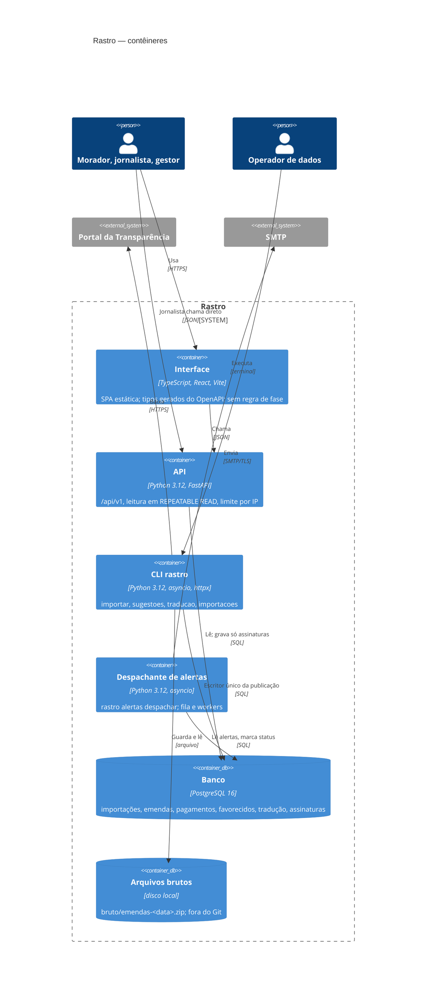

# C4 · Nível 2 — Contêineres (arc42 §5)

## Quem escreve onde

| Contêiner | Escreve | Só lê |
| :-- | :-- | :-- |
| CLI `rastro importar` | `Importacao`, `ImportacaoVigente`, `Emenda`, `Autor`, `Pagamento`, `Favorecido`, `NomeFavorecido`, `Descarte`, `MudancaFase`, `SugestaoMesmaEntidade`, `AlertaEnviado` (criação) | `Assinatura` |
| CLI `rastro sugestoes` / `traducao` | `SugestaoMesmaEntidade.status`, `VersaoTraducao`, `TraducaoFase` | — |
| API | `Assinatura` (criar, confirmar, apagar) | o resto |
| Despachante | `AlertaEnviado.status`, `tentativas`, `enviado_em` | `Assinatura`, `MudancaFase`, `Emenda` |
| Interface | nada | tudo pela API |

A API nunca escreve dado de fonte. Só a CLI de importação abre a transação de publicação, sob `pg_advisory_lock` (ADR-0002, ADR-0007).

## Implantação (arc42 §7, mínima)

Docker Compose com `db` (PostgreSQL 16), `api` (uvicorn), `web` (arquivos estáticos servidos por nginx), `despachante` e `mailpit` (só em desenvolvimento). A CLI roda com `docker compose run --rm cli rastro importar --baixar`, agendada uma vez por dia. CI no GitHub Actions com PostgreSQL de serviço. Hospedagem fora do Compose local: a definir com o grupo (FI-01 §6, "Supabase se precisar").
