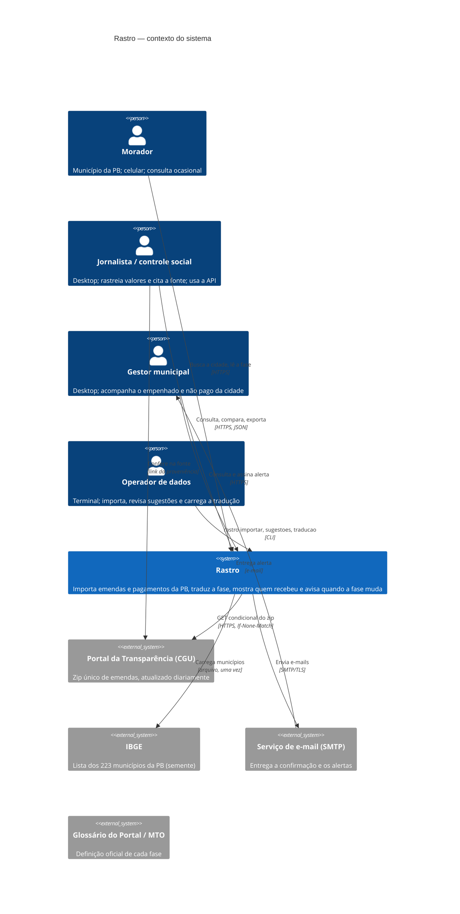

# C4 · Nível 1 — Contexto (arc42 §3)

## Atores e vizinhos

| Elemento | Tipo | Relação | Telas |
| :-- | :-- | :-- | :-- |
| Morador | pessoa | consulta sem conta; e-mail só para alerta | P01, P02, P04, P05, P10, S01–S03 |
| Jornalista / controle social | pessoa | consulta, compara, exporta, usa a API, assina | P01–P10, S01–S03 |
| Gestor municipal | pessoa | acompanha a cidade e assina | P02, P03, P04, S01–S03 |
| Operador de dados | pessoa | roda a CLI | O01, O02, P09, P10 |
| Portal da Transparência | sistema externo | única fonte de dados do MVP; se cair, a vigente anterior continua (REQ-15) | — |
| IBGE | sistema externo | semente de municípios | — |
| Serviço SMTP | sistema externo | entrega; falha vira nova tentativa (REQ-68) | S03 |
| Glossário / MTO | documento externo | citado em `TraducaoFase.fonte_definicao`, não copiado | P10 |

## Afetados que não são usuários (FI-01 §3.2)

| Quem | Requisitos e ADRs que o protegem |
| :-- | :-- |
| Parlamentar autor | REQ-30, REQ-31, REQ-52, REQ-82, ADR-0005 |
| Entidade favorecida | REQ-21, REQ-37, REQ-39, ADR-0001 |
| Pessoa física na fonte | REQ-16, REQ-17, REQ-26, ADR-0004 |
| Município com dado sujo | REQ-40, REQ-55, ADR-0009 |

## Limites

- **Dentro:** download e importação, normalização, descartes, proveniência, fase e tradução, mudanças entre importações, sugestões de mesma entidade, API de leitura, interface, assinaturas e e-mail.
- **Fora (FI-01 §5):** emendas estaduais e municipais; municípios fora da PB; mérito, nota ou ranking de parlamentar; execução física de obra; fusão de CNPJs diferentes; dado de pessoa física; cadastro além do e-mail; Siga Brasil.
