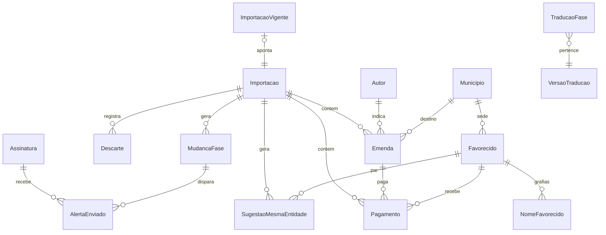

# Modelo de dados — PostgreSQL 16

Entidades, campos e restrições do Rastro. Os nomes `Entidade.campo` são os citados nas fichas de tela e nos requisitos. As restrições ficam no schema, não no código (FI-01 §6): cada uma cita o requisito ou a ADR que ela garante.

Convenções: chaves `bigint` geradas; valores em centavos `bigint`; datas `timestamptz` em UTC; textos da fonte guardados como publicados (sem correção de grafia).

## Diagrama

## Importação e proveniência

### Importacao

| Campo | Tipo | Restrição | Origem |
| :-- | :-- | :-- | :-- |
| `id` | bigint | PK | — |
| `status` | enum `em_andamento`, `publicada`, `falhou` | `NOT NULL` | FI-01 §9 |
| `iniciada_em` | timestamptz | `NOT NULL` | REQ-01 |
| `publicada_em` | timestamptz | `NOT NULL` se `status = publicada` (CHECK) | REQ-09 |
| `motivo_falha` | enum `formato_alterado`, `descartes_acima_do_limite`, `interrompida`, `tempo_esgotado`, `fonte_indisponivel` | `NOT NULL` se `status = falhou` (CHECK) | REQ-07, 08, 11, 12, 15 |
| `sha256` | char(64) | `UNIQUE` entre importações `publicada` (índice parcial) | REQ-05 |
| `fonte_etag` | text | nulo se o arquivo veio por `--arquivo` | REQ-02 |
| `fonte_last_modified` | timestamptz | `NOT NULL` se `status = publicada` | REQ-60, REQ-75 |
| `arquivo_bruto` | text | caminho do zip guardado | REQ-02 |
| `linhas_lidas`, `linhas_no_recorte`, `linhas_aceitas`, `linhas_descartadas` | integer | `≥ 0` | REQ-54 |
| `workers` | smallint | `IN (1, 2, 4)` | REQ-86 |
| `duracao_ms` | jsonb | chaves `download`, `leitura`, `normalizacao`, `publicacao` | REQ-85 |

### ImportacaoVigente

Uma linha só (`id = 1`, CHECK). `importacao_id` → `Importacao.id`, que deve estar `publicada` (trigger). Trocada só dentro da transação de publicação (REQ-09, ADR-0002).

### Proveniencia (colunas repetidas em Emenda, Pagamento e Favorecido)

| Campo | Tipo | Restrição | Origem |
| :-- | :-- | :-- | :-- |
| `fonte` | text | `NOT NULL`, ex. `cgu_emendas` | REQ-28 |
| `arquivo` | text | `NOT NULL`, ex. `EmendasParlamentares_PorFavorecido.csv` | REQ-28 |
| `linha` | integer | `NOT NULL`, `> 1` (linha 1 é o cabeçalho) | REQ-28 |
| `extraido_em` | timestamptz | `NOT NULL` | REQ-28 |

Na API, essas colunas mais `importacao_id` e `url_download` formam o schema `Proveniencia` (ver `openapi.yaml`).

### Descarte

| Campo | Tipo | Restrição | Origem |
| :-- | :-- | :-- | :-- |
| `id` | bigint | PK | — |
| `importacao_id` | bigint | FK, `NOT NULL` | REQ-26 |
| `arquivo` | text | `NOT NULL` | REQ-26 |
| `linha` | integer | `NOT NULL` | REQ-26 |
| `motivo` | enum `favorecido_pessoa_fisica`, `favorecido_empresario_individual`, `favorecido_nao_identificado`, `unidade_gestora_sem_cnpj`, `favorecido_tipo_desconhecido`, `cnpj_invalido`, `valor_fora_do_formato`, `numero_de_colunas_inesperado`, `codigo_emenda_invalido` | `NOT NULL` | REQ-16–20, REQ-24 |
| `municipio_ibge` | char(7) | nulo se a linha não tem município | ADR-0009 |
| `emenda_codigo` | char(12) | nulo se a linha não tem código | REQ-47 |

Sem coluna de nome, CPF, CNPJ ou valor (ADR-0004). `UNIQUE (importacao_id, arquivo, linha)`.

## Emendas e pagamentos

### Municipio

Semente única dos 223 municípios da PB (IBGE). `codigo_ibge` char(7) PK; `nome` text `NOT NULL`; `uf` = `PB` (CHECK).

### Autor

| Campo | Tipo | Restrição |
| :-- | :-- | :-- |
| `codigo` | text | PK (`Código do Autor da Emenda`) |
| `nome` | text | `NOT NULL`, como publicado |
| `tipo` | enum `parlamentar`, `bancada`, `comissao`, `relator`, `sem_autor` | `NOT NULL` |

### Emenda

| Campo | Tipo | Restrição | Origem |
| :-- | :-- | :-- | :-- |
| `importacao_id` | bigint | FK, parte da PK | ADR-0002 |
| `codigo` | char(12) | parte da PK; 12 dígitos (CHECK) | REQ-45 |
| `ano` | smallint | `NOT NULL` | REQ-43 |
| `autor_codigo` | text | FK `Autor` | REQ-53 |
| `tipo` | text | `NOT NULL` (individual, bancada, comissão, relator) | — |
| `funcao_codigo`, `funcao_nome` | text | `NOT NULL` | REQ-51 |
| `municipio_ibge` | char(7) | FK `Municipio`; nulo se destino estadual ou `MÚLTIPLO` | ADR-0010 |
| `localidade_texto` | text | `NOT NULL`, como publicado | ADR-0010 |
| `empenhado_centavos`, `liquidado_centavos`, `pago_centavos`, `rp_inscrito_centavos`, `rp_cancelado_centavos`, `rp_pago_centavos` | bigint | `NOT NULL` | ADR-0005 |
| `fase` | enum (ADR-0005) | coluna gerada pela função `fase(...)` | REQ-30 |
| proveniência | — | ver acima | REQ-28 |

### Favorecido

| Campo | Tipo | Restrição | Origem |
| :-- | :-- | :-- | :-- |
| `cnpj` | char(14) | PK (`UNIQUE NOT NULL`); DV válido (CHECK por função) | REQ-20, REQ-21 |
| `cnpj_raiz` | char(8) | gerada de `cnpj` | REQ-27 |
| `razao_social` | text | `NOT NULL` | REQ-22 |
| `natureza` | text | como publicada; nulo se `Sem informação` | REQ-25 |
| `municipio_ibge` | char(7) | FK `Municipio`; casado pelo nome de `Município Favorecido` (ver `fonte-portal.md`); nulo fora da PB ou sem par | ADR-0010 |
| `uf` | char(2) | nulo se fora do padrão | REQ-25 |
| proveniência | — | da primeira linha em que o CNPJ apareceu na importação | REQ-28 |

O favorecido não é versionado por importação: o `ON CONFLICT (cnpj) DO UPDATE` atualiza `razao_social` e proveniência (ADR-0007).

### NomeFavorecido

`cnpj` FK + `nome` text, PK composta. Cada grafia vista do CNPJ (REQ-22).

### Pagamento

| Campo | Tipo | Restrição | Origem |
| :-- | :-- | :-- | :-- |
| `importacao_id` | bigint | FK | ADR-0002 |
| `chave_pagamento` | char(64) | `UNIQUE (importacao_id, chave_pagamento)` | REQ-06 |
| `emenda_codigo` | char(12) | nulo se `Sem informação` (1 226 linhas no T2) | REQ-25 |
| `cnpj` | char(14) | FK `Favorecido`, `NOT NULL` | REQ-21 |
| `ano_mes` | char(6) | `AAAAMM`, mês 01–12 (CHECK) | T2 R-ANOMES |
| `valor_centavos` | bigint | `NOT NULL`, pode ser negativo | REQ-23, REQ-24 |
| proveniência | — | ver acima | REQ-28 |

## Núcleo

### MudancaFase

`importacao_id` (a nova) FK · `emenda_codigo` · `fase_anterior` · `fase_nova` · PK (`importacao_id`, `emenda_codigo`). `fase_anterior ≠ fase_nova` (CHECK). Emenda nova entra com `fase_anterior` nulo (REQ-34, REQ-35).

### VersaoTraducao e TraducaoFase

`VersaoTraducao`: `versao` integer PK, `carregada_em`, `vigente` boolean (uma só `true`, índice parcial único).
`TraducaoFase`: (`versao`, `fase`) PK; `texto_simples`, `termo_oficial`, `explicacao`, `fonte_definicao` text `NOT NULL`. Toda fase do enum precisa de linha na versão (REQ-33). Linhas nunca são alteradas (REQ-32).

### SugestaoMesmaEntidade

| Campo | Tipo | Restrição | Origem |
| :-- | :-- | :-- | :-- |
| `id` | bigint | PK | — |
| `cnpj_a`, `cnpj_b` | char(14) | FK; `cnpj_a < cnpj_b`; raízes diferentes (CHECK); `UNIQUE (cnpj_a, cnpj_b)` | REQ-36 |
| `confianca` | numeric(3,2) | 0–1 | REQ-36 |
| `origem` | enum `regra_nome`, `modelo_local` | `NOT NULL` | FI-01 §6.1 |
| `status` | enum `pendente`, `relacionadas`, `distintas` | `NOT NULL` default `pendente` | REQ-38, REQ-39 |
| `revisado_por`, `revisado_em` | text, timestamptz | `NOT NULL` se `status ≠ pendente` | REQ-38 |

Nenhuma view de agregação faz `JOIN` com esta tabela (REQ-37; teste `test_sugestao_nao_soma`).

## Saída

### Assinatura

| Campo | Tipo | Restrição | Origem |
| :-- | :-- | :-- | :-- |
| `id` | bigint | PK | — |
| `email` | citext | `NOT NULL` | FI-01 §8.1 |
| `filtro_tipo` | enum `municipio`, `parlamentar` | `NOT NULL` | REQ-61 |
| `filtro_valor` | text | `NOT NULL` (código IBGE ou código do autor) | REQ-61 |
| `status` | enum `pendente`, `ativa` | `NOT NULL` | REQ-64 |
| `token_confirmacao_hash` | char(64) | sha256 do token; nulo depois de confirmada | REQ-61, REQ-63 |
| `token_confirmacao_expira_em` | timestamptz | `criada_em + 48 h` | REQ-61 |
| `token_gestao_hash` | char(64) | `UNIQUE`; nulo enquanto `pendente` | REQ-64 |
| `criada_em` | timestamptz | `NOT NULL` | FI-01 §9 |

`UNIQUE (email, filtro_tipo, filtro_valor)` (REQ-73). Tokens guardados só como hash. `ON DELETE CASCADE` para `AlertaEnviado` (REQ-70).

### AlertaEnviado

| Campo | Tipo | Restrição | Origem |
| :-- | :-- | :-- | :-- |
| `id` | bigint | PK | — |
| `assinatura_id` | bigint | FK `ON DELETE CASCADE` | REQ-70 |
| `emenda_codigo` | char(12) | `NOT NULL` | REQ-65 |
| `importacao_id` | bigint | FK | REQ-65 |
| `status` | enum `pendente`, `enviando`, `enviado`, `falhou` | `NOT NULL` | REQ-68, REQ-69 |
| `tentativas` | smallint | `0–3` (CHECK) | REQ-68 |
| `enviado_em` | timestamptz | `NOT NULL` se `status = enviado` | — |

`UNIQUE (assinatura_id, emenda_codigo, importacao_id)` (REQ-65, FI-01 §9).
