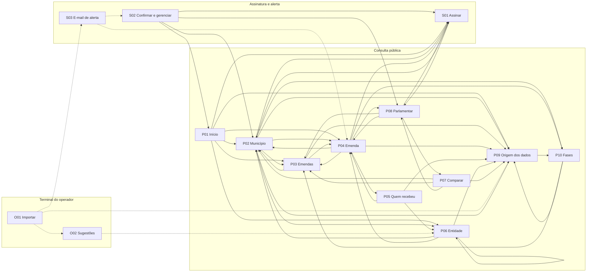

# Inventário e navegação — Rastro

15 telas, quatro atores e três superfícies. Os ids são estáveis e citados nas fichas, na coluna "Telas" de `../arquitetura/requisitos.md` e no mapa abaixo. A coluna e as ligações são conferidas por `../verificar.py`.

Prefixos: **P** = consulta pública · **S** = assinatura e alerta · **O** = operador (CLI).

## Quadro de telas

| ID | Tela | Ator principal | Superfície | Rota / comando | Ficha |
| :-- | :-- | :-- | :-- | :-- | :-- |
| P01 | Início e busca | Morador | Web | `/` | [P01-inicio.md](P01-inicio.md) |
| P02 | Município | Morador, gestor municipal | Web | `/municipios/:codigo_ibge` | [P02-municipio.md](P02-municipio.md) |
| P03 | Emendas: busca e filtros | Jornalista, gestor municipal | Web | `/emendas` | [P03-emendas.md](P03-emendas.md) |
| P04 | Emenda | Morador, jornalista, gestor | Web | `/emendas/:codigo` | [P04-emenda.md](P04-emenda.md) |
| P05 | Quem recebeu | Jornalista, gestor | Web | `/emendas/:codigo/pagamentos` | [P05-pagamentos.md](P05-pagamentos.md) |
| P06 | Entidade favorecida | Jornalista | Web | `/favorecidos/:cnpj` | [P06-favorecido.md](P06-favorecido.md) |
| P07 | Comparar | Jornalista, gestor | Web | `/comparar` | [P07-comparar.md](P07-comparar.md) |
| P08 | Parlamentar | Jornalista | Web | `/parlamentares/:codigo` | [P08-parlamentar.md](P08-parlamentar.md) |
| P09 | Origem dos dados | Jornalista, operador | Web | `/dados` | [P09-origem-dos-dados.md](P09-origem-dos-dados.md) |
| P10 | Como traduzimos as fases | Morador, jornalista | Web | `/dados/fases` | [P10-fases.md](P10-fases.md) |
| S01 | Receber alertas por e-mail | Gestor municipal, morador | Web | `/alertas/assinar` | [S01-assinar.md](S01-assinar.md) |
| S02 | Confirmar e gerenciar | Quem assinou | Web | `/alertas/confirmar#t=…`, `/alertas/minha#t=…` | [S02-minha-assinatura.md](S02-minha-assinatura.md) |
| S03 | E-mail de alerta | Quem assinou | E-mail | `email:alerta` | [S03-email-de-alerta.md](S03-email-de-alerta.md) |
| O01 | Importar e publicar | Operador | CLI | `rastro importar` | [O01-importar.md](O01-importar.md) |
| O02 | Revisar sugestões | Operador | CLI | `rastro sugestoes` | [O02-revisar-sugestoes.md](O02-revisar-sugestoes.md) |

Diretrizes comuns (público, tom, princípios, acessibilidade, convenção de ações): [diretrizes.md](diretrizes.md).

## Cobertura

### Atores × telas

| Ator (FI-01 §3.1) | Telas | Fluxos |
| :-- | :-- | :-- |
| Morador | P01, P02, P04, P05, P10, S01, S02, S03 | F1, F5 |
| Jornalista / controle social | P01, P03, P04, P05, P06, P07, P08, P09, P10 | F2, F3, F6 |
| Gestor municipal | P02, P03, P04, P05, S01, S02, S03 | F4, F5 |
| Operador de dados | O01, O02, P09, P10 | F7, F8 |

### Superfícies × telas

| Superfície | Telas |
| :-- | :-- |
| Web (celular e desktop) | P01–P10, S01, S02 |
| E-mail | S03 (e o `email:confirmacao`, que leva a S02) |
| CLI | O01, O02 |
| API pública | todas as telas web a consomem; `contratos/openapi.yaml` é a documentação para o jornalista |

### Features do FI-01 §4.2 × telas

| # | Feature | No MVP? | Telas |
| :-- | :-- | :-- | :-- |
| 1 | Consultar emendas de um município com fase traduzida e fonte | Sim | P01, P02, P03, P04, P10 |
| 2 | Ver quem recebeu, com entidade unificada por CNPJ e natureza | Sim | P05, P06, O02 |
| 3 | Agregar por parlamentar, município e função | Sim | P07, P08 |
| 4 | Assinar alerta e receber aviso de mudança de fase | Sim | S01, S02, S03, O01 |
| 5 | Histórico do que mudou entre importações | Não (fase 2) | — (a `MudancaFase` já é gravada, REQ-34) |

### Mitigações do FI-01 §8.3–8.4 × telas

| Mitigação | Telas | Requisitos |
| :-- | :-- | :-- |
| Entidade só por CNPJ; sugestão não é fusão | P05, P06, O02 | REQ-21, REQ-37, REQ-39 |
| Pessoa física descartada | P05, P09, O01 | REQ-16, REQ-17, REQ-26 |
| Proveniência em todo valor | P02, P04, P05, P06, P09 | REQ-28, REQ-29, REQ-75 |
| Tradução com termo oficial ao lado | P02, P03, P04, P10, S03 | REQ-31 |
| Descartes por município expostos | P02, P09 | REQ-26, REQ-40, REQ-55 |
| Aviso de que o sistema não avalia mérito | todas as telas P com valores, S03 | REQ-82, REQ-83 |
| E-mail só para o alerta; cancelar apaga | S01, S02, S03 | REQ-62, REQ-70 |

## Mapa de navegação

Gerado a partir do campo "Vai para" das fichas; `../verificar.py` confere que cada ligação aparece também no "Chega de" do destino. Setas tracejadas saem do terminal ou do e-mail.

Navegação global (cabeçalho de todas as telas web): P01 · P03 · P07 · P09 · S01 · busca (cidade → P02, 12 dígitos → P04, 14 dígitos → P06). A faixa de proveniência leva a P09 e o rodapé a P10.

## Fluxos principais

| Fluxo | Sequência | Ator |
| :-- | :-- | :-- |
| F1 Ver minha cidade | P01 → P02 → P04 → P10 | Morador |
| F2 Seguir o dinheiro até quem recebeu | P03 → P04 → P05 → P06 | Jornalista |
| F3 Comparar e aprofundar | P07 → P08 → P04 → P05 | Jornalista |
| F4 Pendências do município | P02 → "Ver as que ainda não foram pagas" → P03 (CSV) → P02 → S01 | Gestor municipal |
| F5 Assinar e receber alerta | S01 → `email:confirmacao` → S02 → … → S03 → P04 | Gestor, morador |
| F6 Conferir a origem | qualquer valor → "Origem" → P09 → download oficial | Jornalista |
| F7 Importar | O01 → P09 (e S03 para os assinantes) | Operador |
| F8 Revisar sugestões | O01 ("N sugestões novas") → O02 → P06 | Operador |
